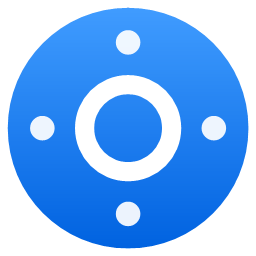
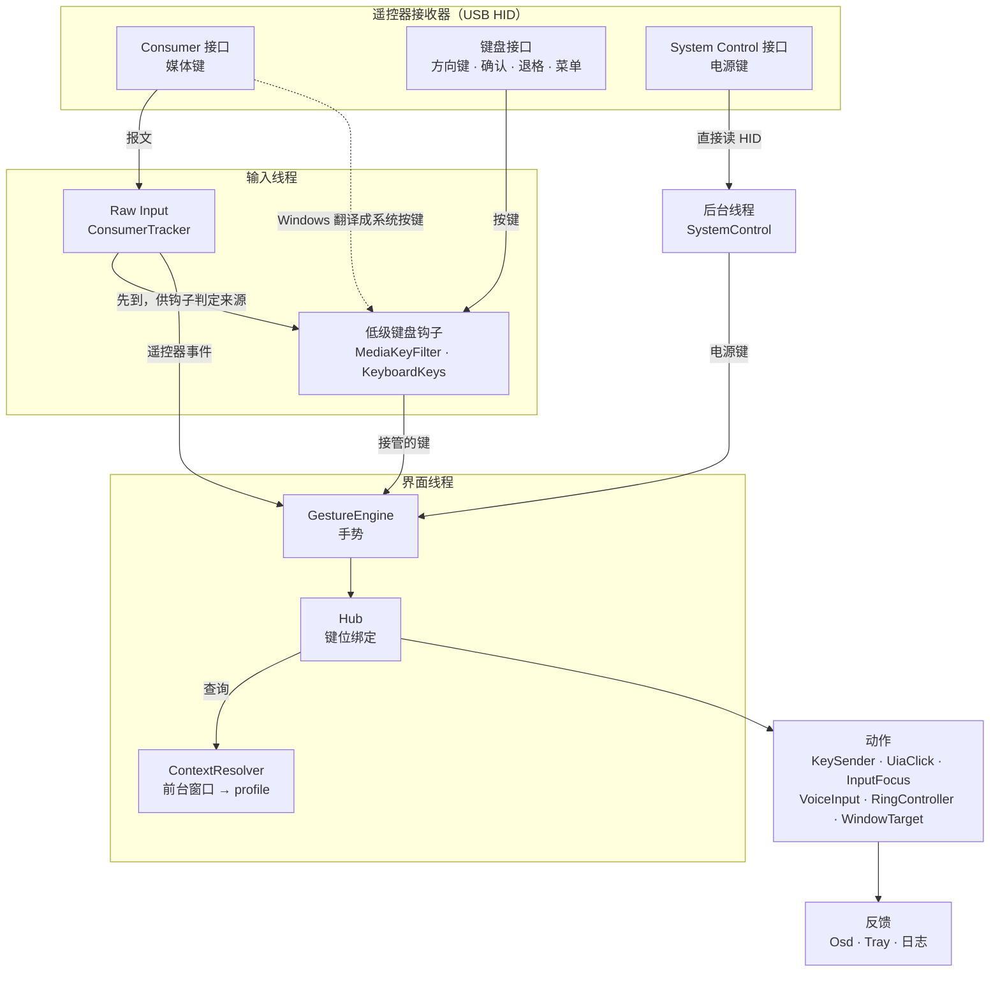

<p align="center">
  
</p>

<h1 align="center">G20S Hub</h1>

<p align="center">
  把 2.4G 飞鼠遥控器变成 Windows 上 AI 对话、写代码的遥控器。
</p>

<p align="center">
  Windows 10 / 11 · 单个 exe，约 140 KB · 不用驱动，也不用第三方库 · MIT
</p>

---

**English**: G20S Hub turns a 2.4 GHz air-mouse remote into a one-handed controller for AI chat and coding tools on Windows: voice input, send, approve, interrupt, and a radial window switcher. It correlates Raw Input reports with media-key events to decide which events to intercept. Keyboard-interface keys have separate rules, described below. Pure C# on .NET Framework 4.8; no third-party drivers or libraries. UI and docs are in Chinese.

本文只讲整体架构和设计思路。具体的键位分配是按作者手上的 G20S Pro 和自己的使用习惯定的，不属于框架本身，都集中在几个文件里，换遥控器或换用法时改那几处就行（见「适配与扩展」）。

## 整体架构



程序里有三类线程，各自只做一件事：

- **输入线程**：判断「这个键是不是遥控器按的、要不要拦」。必须快，所以不做别的。
- **界面线程**：手势识别、键位绑定、动作调度和所有界面都在这里，单线程，不用加锁。
- **后台线程**：UI Automation 的跨进程调用、日志写盘、电源键接口读取、新版本接管监听。

## 模块

| 位置 | 职责 |
|---|---|
| `src/Input/` | `InputThread`：隐藏消息窗口、Raw Input 注册、低级键盘钩子、紧急重启。`ConsumerTracker`：把 Consumer 报文还原成按下 / 抬起。`MediaKeyFilter`：在钩子里判定媒体键的来源。`KeyboardKeys`：键盘接口的键什么时候接管。`SystemControl`：读电源键接口。`RemoteKeys`：设备 VID 和键码表 |
| `src/Gestures/` | `GestureEngine`：把按下 / 抬起变成单击、双击、长按、按住、连发 |
| `src/Actions/Hub.cs` | 键位绑定：每个键需要哪些手势，每个手势做什么 |
| `src/Context/` | `ContextResolver`：按前台窗口匹配 `config.json` 里的 profile |
| `src/Actions/` | 动作的实现：`KeySender`（发按键、滚轮、鼠标点击）、`UiaClick` 和 `InputFocus`（UI Automation）、`VoiceInput`（语音输入）、`WindowTarget`（切换窗口）、`RingController`（窗口圆环的行为） |
| `src/Ring/` | 窗口圆环的数据：`RingSlots` 读写 `ring.json`，`AppCatalog` 枚举窗口、匹配格子、启动程序、取图标 |
| `src/UI/` | WPF 界面（纯代码构建，不用 XAML）：圆环、圆环设置、提示条、日志窗口、托盘 |
| `src/App.cs` · `AppPaths.cs` · `Core.cs` | 入口和单实例接管；数据目录判断；时钟、异步日志、配置读取 |
| `src/Native/Win32.cs` | 全部 P/Invoke 声明 |
| `setup/Setup.cs` | 安装 / 卸载程序（WPF，自己写的） |
| `config.json` | 默认配置，编译时内置进 exe |

## 设计逻辑

### 1. 媒体键按设备报文判定来源，键盘接口按场景接管

核心难点：遥控器的键经过 Windows 翻译后，和真键盘的同名键一模一样。程序要拦下遥控器的键，又不能影响真键盘。

接收器会暴露好几个 HID 接口。Consumer 接口的报文会被 Windows 翻译成 `VK_VOLUME_MUTE`、`VK_MEDIA_PLAY_PAUSE` 这类系统按键，到了低级键盘钩子里已经看不出来源。所以程序同时开两条通道：Raw Input 知道报文来自哪个设备，低级键盘钩子负责拦截。

作者测试的设备中，Consumer 接口的 Raw Input 报文先于翻译出的按键到达钩子。遥控器的动作直接由 Raw Input 报文触发；钩子只负责处理系统翻译出的那个按键：回看最近 `match_ms` 内有没有遥控器发来的同一个 usage，有就拦截，没有就原样放行。未匹配到遥控器报文的媒体键原样放行，不引入等待窗口。按住时系统自动连发的按键沿用第一次按下的判定，抬起也跟着按下走。这是基于时序的关联判定；其他接收器和系统环境仍需要验证。

键盘接口（方向键、确认、退格）正好相反：Raw Input 比钩子晚几十毫秒，钩子那一刻分不出来源。程序**从不**在钩子里扣住这类键去等 Raw Input，那样会弄丢「抬起」，导致按键无限连发。这类键只在两种情况下接管：

- 菜单键（AppsKey）：全局接管，因此真键盘上的同名键也会触发程序动作；
- 窗口圆环打开期间的方向键和确认键：任何键盘上的这些键都会被接管。圆环一关就归还；圆环打开时按下的键，它的抬起也一并吞掉，不会只漏一半给系统。

### 2. 钩子要快，所以单独一个线程

低级钩子超时会被 Windows 直接摘掉，所以：

- 钩子和 Raw Input 放在一条专用线程上，有自己的消息循环，界面卡住也不影响它。
- 钩子回调只查表判定，然后把事件按到达顺序投递给界面线程。
- 钩子回调属于「发送消息」，可能插在已经到达、还没处理的 `WM_INPUT` 前面。所以判定前先用 `PeekMessage` 把队列里的 `WM_INPUT` 取出来处理掉，保证判定时看到的是最新的报文。
- 日志只入队，由单独的线程写盘，钩子里不做磁盘 IO。

### 3. 认得自己发出的按键

程序用 `SendInput` 发出的每个事件，都在 `dwExtraInfo` 里带一个签名，钩子看到签名就放行。不能用 `LLKHF_INJECTED` 判断，因为 Windows 从 Consumer 报文翻译出的媒体键本身就带这个标记。

文字（标点、终端里的 `y`）用 `KEYEVENTF_UNICODE` 发送，绕过输入法组字。

### 4. 手势只在需要时才等待

每个键声明自己需要哪些手势（`Needs`：双击、长按、按住、连发）：

- 只有单击的键，按下立即触发；
- 声明了双击的键，单击要等 `double_ms`，确认没有第二下；
- 声明了长按的键，松开时才确定是单击。

所以延迟只出现在确实要区分手势的键上。连发有硬上限（10 秒），就算丢了「松开」也会自己停。手势引擎跑在界面线程上，用 `DispatcherTimer` 计时。

### 5. 动作由前台窗口决定

同一个键在不同工具里要做不同的事：终端里「允许」是发 `y` 或回车，桌面应用里是点按钮。`ContextResolver` 按前台窗口的 exe、完整路径和标题正则，从 `config.json` 的 `profiles` 里按顺序取第一个匹配项。键位绑定只说「允许」「打断」「插话」，具体怎么做由 profile 决定。

有风险的动作（允许）在识别不出窗口时**什么都不发**，只给提示。

### 6. 操作第三方界面：UI Automation 优先，逐级兜底

桌面 AI 工具多是 Electron 应用，常常没有可靠的快捷键。`UiaClick` 用系统自带的 UI Automation 找按钮，按下面的顺序尝试：

1. 找名称**完全一致**、可用的按钮；有多个时取最后一个，也就是最新出现的那张卡片。
2. 调用 Invoke。700 ms 后按钮还在，说明程序化点击没生效。
3. 在按钮**实时读出**的屏幕位置点一次真实的鼠标，然后把光标移回原处。不用写死的坐标；读位置时线程临时切到每显示器 DPI 感知，多块屏幕缩放不同也能点准。
4. 还不行，再发 profile 里配置的备用快捷键。

找不到按钮时，会把名字疑似相关的候选按钮写进日志，照着把真实名称补进配置就行，不用改代码。Electron 的无障碍树要第一次被查询后才建立，所以取不到时会稍等再试一次。UI Automation 是跨进程调用，全部放在后台线程执行。

发送文字之前，`InputFocus` 会把焦点放回窗口最下方的可编辑输入框（只用 SetFocus，不点鼠标），免得 Enter 落在侧边栏或别的按钮上。

### 7. 读真实状态，不靠推算

语音输入开没开，不按「按了几下」来推算，而是读 Windows 的麦克风使用记录（`CapabilityAccessManager\ConsentStore\microphone`）：录音进程的 `LastUsedTimeStop` 为 0，就是正在录音。输入法自己停止录音、或者用真键盘开关，状态都能跟上。

有的输入法要按住快捷键才录音，这时用 latch 模式，由程序替你按住：

- 按住期间，任何键盘按键都会被钩子暂扣，先松开快捷键再补发，否则会变成「Ctrl+Win+某键」这类系统快捷键；
- 松开 Win 之前先发一个未分配的遮罩键，避免弹出开始菜单；
- 超时、暂停、退出、程序异常时都会自动松开。

插话、换行这类输入文字的动作，会先关掉语音，等录音真正停止、文字上屏后再发送。

### 8. 随时能停下来

程序会拦截和模拟按键，所以每一层都留了退路：

- 真键盘 **Ctrl+Alt+F12** 暂停 / 恢复：在钩子里直接判定，暂停后所有键都走系统默认。
- **紧急重启**在输入线程上执行，不依赖界面线程，界面卡死也有效：松开所有修饰键 → 停止拦截（只继续吞掉遥控器媒体键）→ 启动新实例 → 2.5 秒内没退出就自行结束。
- 退出、暂停、未处理异常时，松开所有可能被按住的键。
- `--dry-run`：只记录和提示，不拦截也不发送任何按键。

### 9. 不抢焦点

圆环和提示条都是 `WS_EX_NOACTIVATE | WS_EX_TOOLWINDOW` 的透明置顶窗口，不抢焦点、不进任务栏，所以弹出时 AI 工具的输入框仍然是焦点。切换窗口时，后台进程直接 `SetForegroundWindow` 常被系统拒绝，`WindowTarget` 会先挂接到当前前台线程的输入队列再切换。

### 10. 零依赖

- **运行**：只用 Windows 自带的 .NET Framework 4.8。WPF 界面纯代码构建，配置用自带的 `JavaScriptSerializer` 读，托盘用 WinForms `NotifyIcon`。
- **编译**：`build.ps1` 直接调用 .NET SDK 里的 Roslyn `csc.dll`，引用系统目录下的程序集。不用 NuGet，不下载任何包。
- **安装**：安装 / 卸载程序也是自己写的，只为当前用户安装，不需要管理员权限。

### 11. 单实例与数据目录

- **新版本接管**：新实例启动时，通过命名事件请旧实例退出，再接管单实例锁。重新编译后直接运行新 exe 就行，不用先关旧的。版本号带编译时间，显示在托盘、提示条和日志第一行，方便确认正在运行的是哪个版本。
- **数据目录**按运行方式自动判断：`--data` 指定的目录 > 从源码运行（项目根目录）> 免安装版（exe 旁边有 `config.json`）> 安装版（`%LOCALAPPDATA%\G20SHub`）。数据目录里没有 `config.json` 时，写出 exe 内置的默认配置。

## 适配与扩展

| 想改什么 | 改哪里 |
|---|---|
| 换一个遥控器 | `src/Input/RemoteKeys.cs`：接收器的 VID，以及各键的 Consumer usage 和系统按键对照表 |
| 每个键做什么、需要哪些手势 | `src/Actions/Hub.cs`：`Specs`（手势需求）和 `OnGesture`（手势 → 动作） |
| 支持新的 AI 工具 | `config.json` 的 `profiles` |
| 时间阈值、语音快捷键、圆环外观 | `config.json` 的 `timing`、`voice`、`ring` |

VID 可以在设备管理器里该设备的「硬件 ID」中查到。改好 VID 后，日志里的 `[Raw]` 行会记下遥控器每个键的 usage。当前实现按 VID 匹配，未进一步限定 PID；同一厂商的其他设备可能也会匹配。

`profiles` 的每一项用 `match_exe`、`match_path`、`match_title_regex` 匹配窗口；`approve`、`steer`、`interrupt` 等动作可以写按键，也可以写 `"uia"`，表示按 `*_names` 里的名称去点按钮。按键写法：`{Enter}`、`{Esc}`、`^{Enter}`（Ctrl+Enter）、`+{Enter}`（Shift+Enter）、`!`（Alt）、`#`（Win），普通字符原样输入。

## 限制

- 键盘接口的键（方向键、确认、退格）分不清来源，不能绑定手势（见「设计逻辑」第 1 条）。
- Windows 的 UIPI 限制：AI 工具以管理员身份运行时，中枢也要以管理员身份运行，才能给它发按键、点按钮。
- 电源键的系统动作（默认睡眠）由 Windows 电源管理执行，程序拦不住，只能另外响应。

## 构建

需要 Windows 10 / 11、.NET Framework 4.8 和 [.NET SDK](https://dotnet.microsoft.com/download)（SDK 只用来编译，运行时不需要）。请使用 PowerShell 7 执行构建脚本。

```powershell
.\build.ps1          # → bin\G20SHub.exe，数据放在项目根目录
.\package.ps1        # → dist\ 下的安装包和免安装 zip
```

版本号写在 [`VERSION`](VERSION) 里。推送 `v*` 标签时，GitHub Actions 会自动打包并发布 Release。

| 命令行参数 | 作用 |
|---|---|
| `--dry-run` | 只记录、只提示，不拦截也不发送任何按键 |
| `--data <目录>` | 指定数据目录 |
| `--preview <目录>` | 把圆环和设置窗口画成 PNG 后退出，用来检查界面，不影响正在运行的实例 |

## 许可证

[MIT](LICENSE) © 2026 Galin
